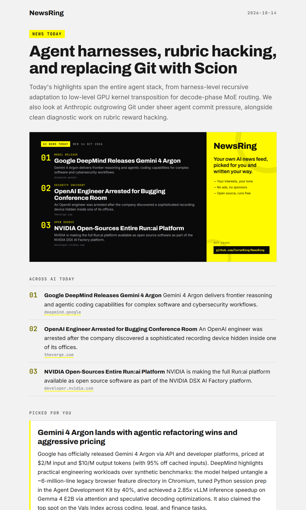
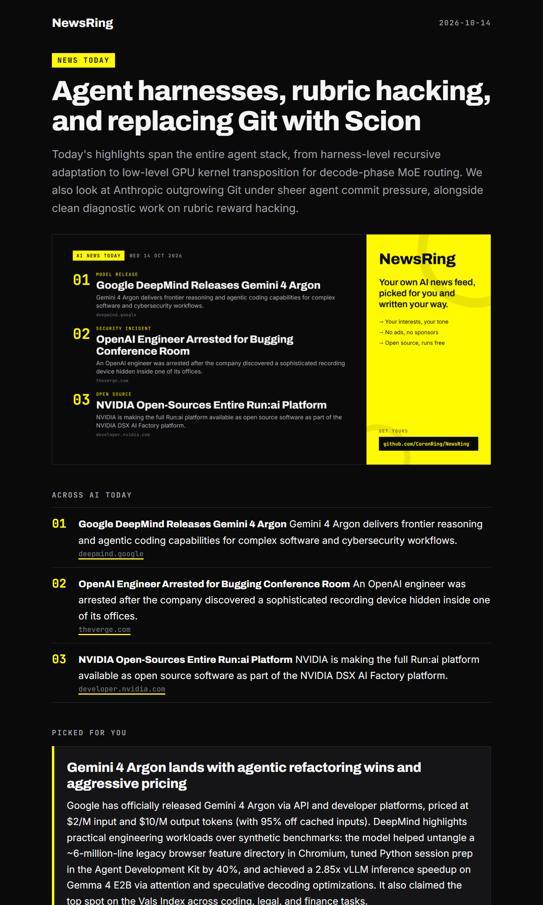
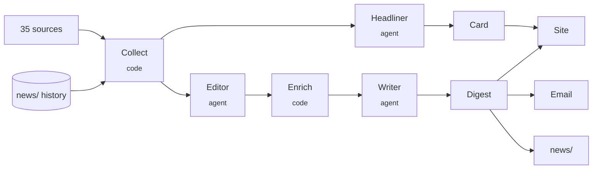

<div align="center">

# NewsRing

**Your own AI news feed. It reads the sources, keeps what you care about, and writes it the way you like to read.**

No ads. No sponsors. No engagement ranking. One config file, free to run.

[](https://github.com/CoronRing/NewsRing/actions/workflows/daily.yml)
[](https://github.com/CoronRing/NewsRing/actions/workflows/ci.yml)
[](pyproject.toml)
[](LICENSE)
[](https://github.com/RailtownAI/railtracks)

<a href="https://coronring.github.io/NewsRing/today.html"></a>

<sub>That card is live. NewsRing rebuilds it every morning at the same URL.<br>
<a href="https://coronring.github.io/NewsRing/today.html"><b>Read today's full digest →</b></a> · <a href="news_today.md">as Markdown</a> · <a href="https://coronring.github.io/blog/news-today">on my site</a></sub>

</div>

---

## Why

Keeping up with AI means skimming forty tabs, most of them press releases, rewritten press releases, and threads about rewritten press releases. Aggregators rank for clicks. Newsletters are written for everyone, which means no one in particular.

NewsRing is the opposite trade. You describe what you care about in plain words. Every morning it reads every source you gave it, keeps the handful of stories that match, and writes them up in the tone you asked for: *brief and dry*, *deep and technical*, *like a patient teacher*, in your language. Then it emails you, and publishes a page you can share.

It is an agent, but a disciplined one. It never browses on its own, never sees a URL it could invent, and every link in your digest points at the real story.

## What you get each morning

| | |
|---|---|
| 📬 **A personal digest** | 5 to 10 stories picked against *your* interests, each with a write-up, why it matters to you, and links to the source and the discussion. Plus quick hits. |
| 🖼️ **A shareable card** | The day's 3 most exciting AI stories for everyone, as a 1200×630 image at a URL that never changes. Put it in your GitHub profile, your site, your team wiki. |
| 🌐 **A static site** | Every digest, archived, on GitHub Pages, with a stable `today.html` and a JSON feed other pages can render. |
| 🗂️ **A plain archive** | One Markdown and one JSON file per day in [`news/`](news), committed to your repo. Your history, greppable forever. |

<p align="center">
  
  
</p>

## Run your own in five minutes

You need a GitHub account and a free LLM key. Gemini's free tier works; so do OpenAI, Anthropic, OpenRouter or a local Ollama.

1. **Fork this repository**, then delete the `news/` folder and `news_today.md`. They are my history, not yours.
2. **Edit [`newsring.toml`](newsring.toml).** Write your interests in plain words, set the tone, and point `site_url` at `https://<you>.github.io/NewsRing/`.
   ```toml
   [profile]
   interests = """
   Robotics and embodied AI, especially open-source hardware.
   New open-weight models I can run on a single GPU, with what actually changed.
   """
   avoid = "Funding rounds, hype pieces, AI policy without technical substance."

   [profile.tone]
   detail = "brief"            # brief | standard | deep
   style = "warm and witty, like a friend who reads everything"
   language = "English"
   ```
3. **Add secrets** in *Settings → Secrets and variables → Actions*:
   - `CHAT_GEMINI_API_KEYS`: one key, or several as `key1,key2`. NewsRing rotates to the next key when one is rate limited.
   - For email, optionally: `NEWSRING_EMAIL_TO` (a comma-separated list), `EMALIA_ADDRESS` and `EMALIA_PASSWORD` (a Gmail [app password](https://myaccount.google.com/apppasswords)).
4. **Turn on Pages**: *Settings → Pages → Source: GitHub Actions*.
5. **Run it**: *Actions → Daily digest → Run workflow*. After that it runs every morning on its own.

Prefer a server or your laptop? `uv sync && uv run newsring run` does the same thing. See [deployment](docs/deployment.md).

## How it works



1. **Collect** (no model): fetch every source concurrently, drop what is old or already sent, cap each source, merge duplicates across sources.
2. **Editor**: one agent sees every candidate side by side and picks your stories, merging duplicate coverage and preferring primary sources.
3. **Enrich** (no model): fetch the full article for each pick.
4. **Writer**: one agent writes the digest in your voice, from that material only.
5. **Headliner**: one agent picks the day's top stories for everyone, for the card.

Agents return story ids, never URLs; links are joined back in code. A normal day is three model calls, about a minute and a half, and well under a cent. The reasoning, including why NewsRing does *not* let an agent browse on its own, is in the [design doc](docs/design.md).

## Sources

35 free feeds and APIs out of the box: frontier labs (OpenAI, Google, DeepMind, Anthropic, Meta, Mistral, Microsoft), Hacker News, Lobsters, Hugging Face daily papers and trending models, release feeds for vLLM, llama.cpp, Ollama, Transformers, Triton and LangChain, practitioner blogs, and tech press. Any RSS or Atom feed is one config block away. [The full list and its quirks →](docs/sources.md)

## Free-tier friendly

LLM free tiers rate-limit hard and popular models go "overloaded" at peak hours. NewsRing is built for that:

- **Key rotation.** Give it several keys; it moves to the next one when a key hits its limit, and stays there.
- **Model fallback.** List fallback models; an overloaded model is skipped for the rest of the call.
- **Cool-down and retry.** If everything is limited at once, it waits and tries the whole set again.

## Commands

| Command | What it does |
|---|---|
| `newsring run` | Produce and publish today's digest. `--dry-run` prints it; `--no-email` skips email; `--lookback-hours N` sets the window. |
| `newsring email` | Email the newest archived digest. |
| `newsring sources` | Check every source, no model calls. |
| `newsring site` | Republish the site and card from the archive. |

## Built on railtracks

NewsRing is also a field test of [railtracks](https://github.com/RailtownAI/railtracks), the agent framework it runs on. Everything that was confusing, missing or surprising while building it is written up in [RT_FEEDBACK.md](RT_FEEDBACK.md).

## Contributing

Issues and pull requests are welcome, especially new source kinds and tone presets. See [CONTRIBUTING.md](CONTRIBUTING.md). If NewsRing saves you some tabs, a ⭐ helps other people find it.

## License

[MIT](LICENSE)
