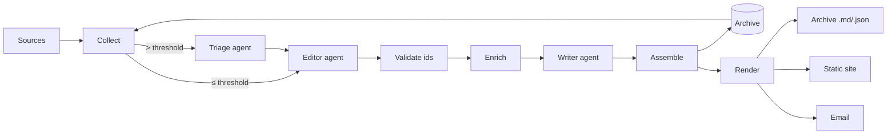

# NewsRing design

**Version 0.2.0** · October 2026

NewsRing is a personal news agent. Once a day it reads a list of free sources, picks the stories that match one reader's stated interests, and writes them up in the tone that reader asked for. The only product is the digest itself: a Markdown and HTML page, archived, optionally emailed, and optionally published as a static site.

It has two goals, and they carry equal weight:

1. **Exercise [railtracks](https://github.com/RailtownAI/railtracks) on a real, small, daily workload** and write down every gap and piece of friction found along the way, in [`RT_FEEDBACK.md`](../RT_FEEDBACK.md).
2. **Produce a useful daily digest** for its author, hosted for free apart from the model calls.

## Inputs

| Input | Where it lives | Notes |
|---|---|---|
| What the reader cares about | `[profile] interests`, `avoid` | Free text. This is the main ranking signal, so specifics beat categories. |
| How many stories | `[profile.count] min`, `max`, `quick_hits` | A range, not a number. The editor may go under `min` on a slow day and must say why. |
| Tone | `[profile.tone] detail`, `style`, `language` | `detail` is `brief`, `standard` or `deep`; `style` is free text such as "dry and lightly humorous". |
| Sources | `[[sources]]` | RSS, Atom, and three JSON APIs. See [sources.md](sources.md). |

Everything is in one TOML file, described field by field in [configuration.md](configuration.md).

## The central decision: collect first, then let the model choose

There are two broad ways to build this.

- **Agentic browsing.** Give an agent the reader's interests and tools such as `list_sources`, `fetch_source` and `read_article`, and let it decide what to read.
- **Collect, then select.** Fetch every source deterministically, normalize and deduplicate, then hand the model the whole candidate list at once and ask it to choose.

NewsRing uses **collect, then select**, with one agentic idea kept where it pays: the full text of a story is fetched only after it has been picked.

| | Agentic browsing | Collect, then select |
|---|---|---|
| Coverage | Whatever the agent chose to open. Silent gaps are likely and invisible. | Every source, every day. A failure is reported per source. |
| Comparison | Sees sources one at a time, so it cannot rank across them well. | Sees all candidates side by side, so it can rank and merge duplicate coverage. |
| Cost | Tokens spent on navigation and on pages it then discards. Grows with the number of sources. | Fetching is free. One editor call over compact candidate lines, one writer call. |
| Determinism | Two runs read different things. Hard to debug or evaluate. | The candidate list is reproducible and stored, so a bad pick can be traced to its input. |
| Links | The model handles URLs, so it can mangle or invent them. | The model only ever sees ids like `c17`. Links are joined back in code. |
| Where agency helps | Following up on a story, reading the article. | Enrichment does this, deterministically, for picked stories only. |

The cases where agentic browsing would win are open-ended ones, such as "find me anything about X, wherever it is". A digest over a fixed list of feeds is not that problem. An agentic mode is still worth building later, as a comparison that also exercises railtracks' tool-calling loop; see [Future work](#future-work).

## Pipeline

| Step | Kind | What it does |
|---|---|---|
| **Collect** | Code | Fetches every enabled source concurrently, parses it into `Item`s, drops items outside the time window or already sent, keeps each source's best `max_items`, merges items that share a canonical URL, and numbers the rest `c1`, `c2`, … newest first. |
| **Triage** | Agent, batched | Only when there are more than `triage_threshold` candidates. Scores batches of `triage_batch_size` 0 to 10 in parallel through `rt.call_batch` and keeps the best `triage_keep`. A failed batch keeps a neutral score rather than vanishing. |
| **Editor** | Agent | Sees every remaining candidate as two or three compact lines (title, source, signals, snippet) and returns the main picks in order, related ids to merge into each pick, quick hits, and an optional slow-day note. |
| **Validate** | Code | Drops unknown ids, uses each id once, enforces `count.max` and `quick_hits`. |
| **Enrich** | Code | Fetches the article for each pick whose feed carried little text, extracting the main text with trafilatura. Best effort. |
| **Writer** | Agent | Writes the title, intro, one write-up per pick, one line per quick hit, in the reader's voice, from the source material only. |
| **Assemble** | Code | Joins the prose with the items by id, in the editor's order. A story the writer skipped falls back to its title and snippet, so a link is never lost. |
| **Render and deliver** | Code | Markdown and HTML from the same record. Archive always; site and email when configured. |

### Why three agents and not one

The editor and the writer are separate because the writer needs the full article text and the editor must not: fetching full text for 200 candidates would be slow, costly, and mostly wasted. Splitting them also lets each prompt do one job, and lets the editor's choice be validated in code before any prose is written.

Triage exists only to keep the editor's prompt bounded. With the default sources the pool was 76 candidates for a 24-hour window and 111 for 72 hours, because the per-source caps bound it, and one editor call handles that comfortably. Triage switches on when someone adds a firehose such as raw arXiv. Forced on for testing (threshold 40, batches of 30), the four batches ran concurrently but each took about 40 seconds, so at this pool size triage costs time rather than saving it.

All the agents are structured-output `rt.agent_node`s with no tools. railtracks does not allow `tool_nodes` and `output_schema` on the same agent, and none of these steps needs a tool: everything they need is put in the prompt.

### Trust boundary

Model output is treated as untrusted structure. The model never sees a URL and never returns one; it returns candidate ids, which are checked against the pool. Prose from the model is HTML-escaped in titles and rendered through markdown-it with raw HTML disabled in bodies. Feed content is untrusted input to the model too: a feed item could carry a prompt injection, and the worst it can do is distort the prose or the ranking, because the model has no tools and cannot produce links.

## State and history

The archive directory (`news/`) is the only state. Each run writes `news/<date>.json` (the full `DigestRecord`) and `news/<date>.md`. The next run reads the records from the last `history_days` days to learn:

- **When the last digest was made.** The window starts two hours before that, so nothing published in the gap between runs is missed. It never reaches further back than `max_lookback_hours`, so a week offline does not produce a digest of stale news.
- **Which stories were already sent.** Their canonical URLs are excluded, including related coverage and quick hits.

A record for the run's own date is ignored, so re-running a day regenerates it instead of treating its own stories as already sent.

This design means a deployment needs no database. A scheduled job persists state by committing one directory, and the archive is also a readable history of every digest.

### Canonical URLs

Two items are the same story when their canonical URLs match: scheme and `www.` dropped, host lower-cased, tracking parameters (`utm_*`, `ref`, `fbclid`, …) and fragments removed, trailing slash stripped. The same paper on arXiv and on Hugging Face Papers collapses to `arxiv:<id>`. Different articles about the same event are merged by the editor through `related_ids`, since that needs judgement.

## Railtracks usage

| Railtracks feature | Where |
|---|---|
| `rt.Flow` | `pipeline.build_flow`: the run's entry point, with `save_state` from config. |
| `@rt.function_node` | `pipeline.produce_digest`: the Flow's entry point, taking a `RunRequest` dataclass. |
| `rt.agent_node(output_schema=...)` | `agents.build_agents`: Triage, Editor, Writer. |
| `rt.call` | Editor and Writer steps. |
| `rt.call_batch` | Triage, one call per batch, run concurrently. |
| `response.structured` | Reading every agent's typed output. |
| `rt.llm.*` providers | `llm.build_llm`: provider and model come from config. |
| `rt.enable_logging` | CLI `--verbose`. |

Findings from building against these are in [`RT_FEEDBACK.md`](../RT_FEEDBACK.md).

## The top stories card

Alongside the personal digest, each run picks the few most exciting AI stories of the last `headlines.window_hours` (72 by default) for a general audience, and renders them as a 1200×630 image. The card is the shareable half of NewsRing: it is not personalized, it lives at one URL that never changes (`today.png`), and its right-hand panel tells whoever sees it how to get their own feed.

- **One fetch, two pools.** Collection runs once with the longer of the two windows. The digest's pool is cut to the run's window and drops stories already sent; the card's pool keeps the full 72 hours and ignores history, so a big story stays on the card while it is still the story. Pool ids use different letters (`c17`, `h17`) so they cannot be confused.
- **A fourth agent.** The Headliner picks the stories and writes a kicker, headline and one-sentence blurb for each. Its prompt ranks for a general technical audience, not the reader's profile.
- **Optional by design.** A failed Headliner call or a missing browser leaves the card out, logged, and the digest is delivered as usual.
- **Rendering.** The card is HTML and CSS in the author's brand (Archivo, Inter, JetBrains Mono, `#fffa00` on `#0a0a0b`), screenshotted at 2× by any Chromium-based browser in headless mode. GitHub runners have Chrome; Windows has Edge. No browser-automation library is needed.

The same stories appear as an "Across AI today" section at the top of the digest page and the email, so the email does not depend on an image that will show a different day when the email is reopened later.

## Model failover

On free tiers each API key has a small per-minute and per-day quota, and popular models return 503 "high demand" at peak hours. With several keys in `api_key_env` or any `fallback_models`, `newsring.llm.FailoverLLM` wraps one client per model and key:

- a **429** moves to the next candidate, usually the same model on the next key;
- a **5xx or timeout** skips the rest of that model's keys, since the model itself is overloaded;
- anything else is raised at once;
- when everything has failed, it waits `rotation_cooldown` seconds and tries again, up to `rotation_rounds` passes;
- it stays on whichever candidate last worked, so the rest of the run does not hit the same limit.

It is a `ModelBase` subclass rather than middleware because railtracks resolves an agent's model once per call, before middleware runs, so middleware cannot change the key. 503s are recognised by walking the exception's cause chain for an HTTP status, because railtracks wraps them in a generic `ModelError`. Gemini model names that litellm's catalog does not know yet go through Gemini's OpenAI-compatible endpoint. All of this is written up in `RT_FEEDBACK.md`.

Each record's `stats.served_by` lists which model and key answered each call.

## Delivery and hosting

Every destination renders from the same `DigestRecord`.

- **Archive** (always): `news/<date>.json` and `news/<date>.md`, plus `news_today.md` at the repository root with the card on top.
- **Static site** (`delivery.site_dir`): one dated page per digest, rebuilt from the whole archive each run so template changes apply retroactively, plus fixed URLs for the newest digest: `today.html`, `today.png`, `news_today.json` and `news_today.md`. Pages follow the reader's light or dark setting.
- **Email** (`delivery.email.enabled`): sent through [Emalia](https://github.com/CoronRing/GS-Emalia)'s `MailClient`, one message per recipient so a list never exposes its addresses. Email clients ignore CSS variables and most of `<style>`, so the email is a separate template with inline styles in a single light theme.

### Showing today's news on another site

The author's website shows the newest digest as a blog post ("News Today") without being rebuilt daily. NewsRing's Pages site shares the `coronring.github.io` origin, so the post's component fetches `/NewsRing/news_today.json` when the page is viewed and renders it in the site's own styles. Plain-text fields are inserted as text; only the `*_html` fields, rendered by NewsRing from Markdown with raw HTML disabled, are inserted as HTML. The post's cover image is `today.png`, so the post's card on the home page changes daily too.

Fetching JSON was chosen over the alternatives:

- **Rebuilding the site daily** would couple the two repositories and redeploy a whole site for one page.
- **Fetching `news_today.md` from the repository** would need a Markdown renderer in the browser and the raw GitHub CDN's five-minute cache.
- **An iframe of `today.html`** would not inherit the site's typography or theme.

### Hosting

The recommended deployment is a scheduled GitHub Actions workflow, which is free for this workload, needs no server, commits `news/` back as state, and publishes the site to GitHub Pages. The workflow splits into a digest job (model keys only), a deploy job, and an email job (mail credentials only) that runs after deploy so the email's web link already works. Running on an always-on host with cron works the same way. Both are covered in [deployment.md](deployment.md).

## Costs

The only paid component is the model, and on Gemini's free tier it is free. A normal day makes three model calls (Headliner, Editor, Writer), or a few more when triage runs.

Measured on 2026-10-14 with `gemini-3.8-flash` and two free keys: three calls, 26,534 input and 7,699 output tokens. railtracks reported $0.049, which is litellm's list price; the free tier charged nothing. With `gpt-6-luna` on 2026-10-13, a two-call day cost $0.0033.

Wall-clock time is 1.5 to 4 minutes. Collection takes a few seconds; most of the rest is model latency, which on the free tier varies with load, and the Gemini run above spent extra time failing over from an overloaded model.

Each run's token totals and cost are stored in the archive record (`stats.usage`) and shown at the foot of the digest.

## Future work

Proposed, not built:

- **Agentic mode for comparison.** A tool-calling agent with `list_sources`, `fetch_source` and `read_article`, run on the same day's sources, to compare picks, cost and coverage against the pipeline. It would also exercise railtracks' tool loop, which the pipeline deliberately does not use.
- **Feedback loop.** Thumbs-up and thumbs-down links in the email or site that append to a small preference log the editor reads, so the profile sharpens over time.
- **Evaluation.** Score each day's picks against the profile with a judge model, using EvalRing, so prompt or model changes can be compared on stored candidate lists.
- **Per-topic sections.** Let the editor group picks under the reader's interest headings.
- **More source kinds.** Reddit JSON, Bluesky lists, YouTube channel feeds, and newsletters through an inbox read by Emalia.
